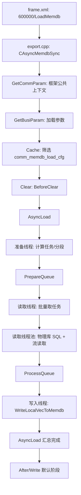

# 600000 数据加载功能排错报告

## 1. 报告范围

本文只分析日终清算的功能号 `600000`，对应 `cbs_memdb_sync` 模块的“从物理库加载数据到内存库”流程。分析依据为当前工作区源码，重点覆盖：

- 运行入口和清算七阶段调用顺序；
- 配置筛选、任务分段、物理库读取、内存库写入；
- 外层线程、读取线程池和两个有界队列的关系；
- 正常、等待、超时和异常情况下的关键日志；
- 后续现场排错应优先核对的代码行为。

源码版本参考：`macbs-base` 最近相关提交 `8689d6b52e7`（2026-08-25，FS-CBS-21140）。

## 2. 入口和总体结论

### 2.1 运行入口

日终配置 `macbs-base/bin64/conf/frame.xml:33-35` 将功能号映射为：

```text
func_id  = 600000
module   = LoadMemdb
library  = libcbs_memdb_sync.so
timeout  = 60
```

`macbs-base/lbm_pro/macbs/cbs_memdb_sync/export.cpp:17` 通过导出宏绑定：

```text
LoadMemdb -> CAsyncMemdbSync -> DoClear()
```

`CAsyncMemdbSync` 继承 `CMemdbSyncBase`，最终使用 `CMacbsClearBase` 的七阶段执行骨架。该功能的业务阶段覆盖情况如下：

| 阶段 | 实际实现 | 主要职责 |
|---|---|---|
| 公共参数 | 框架内部 | 初始化流程上下文、日历、日志级别和基础对象 |
| 业务参数 | `CAsyncMemdbSync::GetBusiParam()` | 读取线程数、批次、表过滤、分段和超时参数 |
| 前处理 | 基类默认空实现 | 直接进入加载缓存阶段 |
| 加载缓存 | `CAsyncMemdbSync::Cache()` | 从物理库读取 `comm_memdb_load_cfg` 并按上下文筛选 |
| 前检查 | 基类默认空实现 | 直接进入处理阶段 |
| 处理 | `CAsyncMemdbSync::Clear()` | 清表、替换 SQL、启动三条并行链路 |
| 后处理 | 基类默认空实现 | 直接进入写入阶段 |
| 写入 | 基类默认空实现 | 600000 的数据已经在处理阶段写入 MemDB，此阶段主要产生框架计时日志 |

### 2.2 总体运行逻辑



最重要的结论是：

1. 600000 的真正数据加载在 `Clear()` 阶段完成，`Write()` 阶段不是主写入点。
2. 外层固定启动 3 个异步任务：准备线程、读取线程、写入线程。
3. 读取线程内部还会启动 `threadnum` 个 `CJstpThreadPool` 工作线程，因此总并发不只是 3 个线程。
4. 物理库读取在每个任务自己的 MemDB 管理对象中完成，读取结果先进入 `ProcessQueue`，再由单独写入线程批量写入目标内存库。
5. 任务完成以“表/批次任务”计数，记录数以读取日志和写入汇总日志为准，不能只看“配置条数”。

## 3. 阶段运行逻辑

### 3.1 公共参数阶段

`CMacbsClearBase::DoClear()` 先执行 `GetCommParam()`，然后才调用派生类的 `GetBusiParam()`。公共参数包括 `busidate`、`instid`、`partid`、`insttype`、`begin_settgroup`、`end_settgroup`、`sno`、`flowchartid` 和 `flowrecordresultid` 等。

公共初始化还会：

- 删除本次流程之前的流程日志；
- 补全当前实例信息；
- 加载流程日志级别；
- 初始化清算日历；
- 初始化缓存调试、缓存内存统计和特色配置。

清算日历在 `CAsyncMemdbSync` 构造函数中将 `m_bClearCalendarPtrType` 设为 `false`，也就是使用值类型加载，避免日历表读锁影响后续写入。

关键日志：

```text
Start(),...funcdesc(加载日历表开始),...
Stop(),...funcdesc(加载日历表完成,共加载[%ld]条),...
m_nDBType=%d
```

如果日志中连 `m_nDBType` 都没有，问题通常还在公共参数初始化或 COMM 数据源连接阶段。

### 3.2 业务参数阶段 `GetBusiParam()`

实现位置：`macbs-base/lbm_pro/macbs/cbs_memdb_sync/memdb_sync/async_memdb_sync.cpp:15-139`。

参数读取优先级是流程入参 `TryGetValue()`，缺失时再从混合配置读取；部分参数还有代码默认值和范围修正。

| 参数 | 用途 | 当前代码行为 |
|---|---|---|
| `threadnum` | 读取线程池大小 | 流程参数优先；缺失时混合配置默认值为 `1`；没有正数校验 |
| `batchnum` | 单个 SQL 任务的记录批量大小 | 缺失时混合配置默认 `1000000`，随后限制到 `[10000, 500000]`，因此该路径缺省通常变为 `500000` |
| `batchsettgroupnum` | 结算分组分段大小 | 小于 `100000` 时重新取混合配置；最终至少为 `100000` |
| `cfggroup` | 配置分组过滤 | 只保留 `cfg_group` 中包含该值的配置 |
| `truncate_flag` | 清空策略 | 默认 `'0'`，表示全部清空；如果传入 `tablename`，代码强制改为 `'1'` |
| `tablename` | 指定加载表，逗号分隔 | 只加载匹配表，并触发当前表清空策略 |
| `allByCount` | 是否全部按记录数分段 | `'1'` 会进入特殊分支，见第 4.2 节风险说明 |
| `unordered` | 是否按哈希打乱配置顺序 | `'1'` 时按表名和序号前缀哈希降序排列 |
| `mod_count` | 取模加载的模数 | 成员初始值为 `512` |
| `whitelist_table` | 测试白名单 | 当前只在取模任务分支中生效，含义是过滤掉名单中的表 |
| `prepare_queue_size` | 准备队列容量 | 只有流程显式传参时才调用 `SetMaxSize()` |
| `process_queue_size` | 写入队列容量 | 只有流程显式传参时才调用 `SetMaxSize()` |
| `timeout` | 内部任务超时时间 | 缺失时为 `600` 秒，要求与任务超时配置一致 |
| `coreid` | SQL 核心号占位符 | 替换 `:coreid` |

非 `COMM` 实例会额外读取当前实例的 `compute_node_num`，写入 `m_nInstacneCount`；查不到时抛出 `200502186`。`NODEX` 实例还会从 `node_settgroup` 查询最小、最大结算分组，覆盖 `begin_settgroup/end_settgroup`。

关键日志：

```text
当前DB连接名称[%s]                         // NODEX 查询结算分组时
上场参数-cfggroup:{}, timeout:{}, ...       // 完整参数摘要
上场参数-prepare_queue_size:%d, process_queue_size:%d, timeout:%d...
```

排错时应记录完整的“上场参数”行。它能直接决定后续是按记录数、取模还是结算分组分段，以及是否发生队列背压。

### 3.3 加载缓存阶段 `Cache()`

实现位置：`async_memdb_sync.cpp:141-198`。

此处的“缓存”主要是把物理库中的 `comm_memdb_load_cfg` 配置缓存到物理库管理对象，不是把业务数据写入目标 MemDB。

查询条件和过滤顺序：

1. `enable_flag = FLAG_YES`；
2. 按 `source_inst_type` 排序；
3. 如果传入 `cfggroup`，保留配置组匹配的记录；
4. 如果传入 `tablename`，保留表名匹配的记录；
5. 保留 `inst_types` 包含当前实例类型的配置；
6. SQL 加载方式必须同时出现 `:begin_settgroup` 和 `:end_settgroup`，否则抛出 `200502286`；
7. 同时存在两个占位符的配置标记 `m_bRange = true`，并为占位符增加类型标注，供后续 `kcps_stream::set_param()` 绑定。

关键日志：

```text
从物理库加载数据到内存库，加载到配置[%zu]条
```

注意：该数量是清除空表配置、排序和生成实际分段任务之前的配置数，不能直接当作最终任务数或最终加载记录数。

### 3.4 处理阶段 `Clear()`

实现位置：`async_memdb_sync.cpp:200-209`。

该阶段只做两件事：

```text
BeforeClear();
AsyncLoad();
```

框架会在阶段外层输出：

```text
Start(),...funcdesc(业务逻辑处理开始),...
Stop(),...funcdesc(业务逻辑处理完成),...
```

#### 3.4.1 `BeforeClear()`

实现位置：`async_memdb_sync.cpp:212-282`。

处理步骤：

1. `truncate_flag = '0'`：调用 `ResetDatabase()` 清空 MemDB，然后调用 `SysInitData()` 加载系统必需表。
2. `truncate_flag = '1'`：对当前 `Cache()` 阶段保留下来的配置逐表调用 `TruncateTable()`。
3. 其他标志抛出 `200502486`。
4. 检查取模分段和结算分组分段是否同时配置；同时出现时抛出 `200504486`。
5. 替换公共 SQL 参数，包括 `mod_count`、`sno`、流程号、业务日期、实例号、分区号、计算节点和 `coreid` 等。
6. 查询并替换融券专户、融券专户资金账号；SQL 中存在两融补充占位符时，还会查询并替换 `:needsupplement`、`:needrighttocash`。
7. 删除 `load_method = MEMDB_LOAD_METHOD_EMPTY` 的配置，因为该类配置只需要清表。
8. `unordered = '1'` 时按表名和序号前缀哈希重新排序。

计时日志：

```text
Start(),...funcdesc(清空全部表),...
Stop(),...funcdesc(清空全部表结束),...
Start(),...funcdesc(替换SQL中的变量，剔除空表加载的配置),...
Stop(),...funcdesc(替换SQL中的变量，剔除空表加载的配置结束),...
融券专户:rqSpeSecuid=[%s]
融券专户资金账号:rqSpeFundacct=[%s]
两融合约补充条件:needsupplement=[%s]
两融合约补充条件:needrighttocash=[%s]
```

如果 `ResetDatabase()` 失败，错误码为 `200504386`，日志中应包含 MemDB 错误码和错误信息。

## 4. 任务分类和分段逻辑

准备线程入口：`async_memdb_sync.cpp:345-430`。它先调用 `DBSelectComm()`，随后调用 `CMemdbSyncShared::CalcRange()` 将配置分入三类：按记录数、按取模、按结算分组。

### 4.1 分类规则

| 条件 | 任务分类 | 后续处理 |
|---|---|---|
| `comm_accountmapped` 且当前为 `NODEX` | 特殊取模 | 按 64 个分区、512 个 hash 值生成 512 个任务 |
| `allByCount = '1'` | 特殊分支 | 替换结算分组变量，当前代码不在此处入队 |
| `load_method = ALL` | 按记录数 | 进入记录总数统计和主键分页 |
| SQL 且无结算分组、无实例节点占位符 | 按记录数 | 进入记录总数统计和主键分页 |
| SQL 中包含实例节点占位符 | 按取模 | 计算当前节点的取模映射并替换 SQL |
| 其他 SQL | 按结算分组 | 从 `node_settgroup` 生成范围任务 |

取模模式会根据当前节点序号、实例数量和 `mod_count` 计算映射；实例数量为 1 至 5 时，会分别把多个取模值合并到一个 SQL 任务中，以减少任务数。正常流程日志为：

```text
获取当前应用编号=[...],总共计算节点数量=[...],映射序号=[...]
待执行表名[%s]SQL[%s]                         // TRACE 级别
```

### 4.2 按记录数分段

实现位置：`shared_sync.cpp:476-578`。

1. 对每张表并发执行记录数统计，统计线程数为 `min(表数, threadnum) / 2 + 2`。
2. 单张表的统计等待上限为 180 秒，超时抛出 `200511286`。
3. 统计 SQL：
   - `ALL`：`select count(1) from <table>`；
   - SQL：`select count(1) from (<executesql>)`。
4. 取 MemDB 管理类提供的主键和全部字段，按主键构造分页 SQL。
5. GAUSS、SQL Server、GoldenDB 使用 `limit offset,size`；其他数据库使用 `row_number()` 范围。
6. 每批任务的大小是 `batchnum`，最后一批可能超出统计总数，但 SQL 实际返回记录数不会超出结果集。

关键日志：

```text
开始执行统计[%s]数量
[统计],表[%s],共[%d]条
结束执行统计[%s]数量
表[%s]按查询结果条数为0，无需加载
表[%s]按记录顺序分段完成,共分为[%d]段
```

统计异常错误码：

```text
200511286  统计表[{0}]超过180秒
200511386  统计表[{0}]的记录数失败:[{1}]
200511486  未找到表[{0}]的内存数据库管理者
200511686  统计表[{0}]的参数配置错误
200511786  统计表[{0}]的记录数错误
200511886  统计[{0}]表发生异常
```

### 4.3 按结算分组分段

实现位置：`shared_sync.cpp:580-697`。

1. 切换到 Node 数据源，读取 `node_settgroup`。
2. 非 NODEX 按 `begin_settgroup/end_settgroup` 过滤；NODEX 读取全部结算分组。
3. 使用 `row_number()` 或数据库对应的 `mod()` 语法，每隔 `batchsettgroupnum` 取边界点。
4. 边界点为奇数时，使用当前 `end_settgroup` 补齐最后一段。
5. 如果启用了动态结算分组加载：
   - 普通任务排除当前节点需要移除的结算分组；
   - 额外生成当前节点需要补充的结算分组任务；
   - SQL 过长时改用 `comm_cust_trade_weight_allocsno_info` 子查询。
6. 把每个 `[begin_settgroup, end_settgroup]` 复制成一个任务，设置 `m_bRange` 的 SQL 参数。

关键日志：

```text
当前DB连接名称[%s]
从数据库读取所有的结算分组,耗时:%ld ms
从流读取结算分组,耗时:%ld ms
按结算分组分段完成,共分为[%zu]段,耗时:%ld ms
```

当前 600000 的准备线程调用的是 `CalcRangeBySettgroup()`；源码中的 `CalcRangeBySelfSettgroup()` 在该路径没有被 `CAsyncMemdbSync::PreparerDataThread()` 调用，不能用它的日志判断 600000 是否执行过。

## 5. 线程模型和同步关系

### 5.1 线程层次

`AsyncLoad()` 在 `async_memdb_sync.cpp:285-343` 中使用 `std::async(std::launch::async)`启动三条异步链路：

| 线程/线程组 | 创建点 | 作用 | 退出条件 |
|---|---|---|---|
| 准备线程 | `futurePreparerData` | 计算任务、生成分页/取模/结算分组任务，推入准备队列 | 全部任务生成后 `m_PrepareQueue.stop()` |
| 读取线程 | `futureReadData` | 从准备队列取任务，维护 future，负责读结果和任务统计 | 准备队列已停止、为空且所有读取 future 已完成 |
| 读取线程池 | `CJstpThreadPool(threadnum)` | 每个任务切换数据源、执行 SQL、流读取到 MemDB 管理对象本地 vector | `ReadDataThread()`退出，线程池析构 join |
| 写入线程 | `futureWriteData` | 从写入队列取 MemDB 管理对象，批量写入目标 MemDB | `m_ProcessQueue` 已停止且为空，或内部超时/异常 |

### 5.2 队列

队列类型是 `SafeBlockQueue`，实现位置 `library/macbs/comm/safe_blockqueue.h`。

```text
准备线程 --push--> PrepareQueue --pop--> 读取线程
读取线程池 --push--> ProcessQueue --pop--> 写入线程
```

队列特征：

- `push()` 和 `pop()` 每次默认只等待 10 微秒；失败后由业务循环 `SLEEP(1)` 重试。
- `stop()` 只设置停止标志并唤醒生产者和消费者；消费者仍可以把停止前残留的数据读完。
- 准备队列和写入队列的构造容量都是 100。
- 只有显式传入 `prepare_queue_size` 或 `process_queue_size` 时才会覆盖容量。

### 5.3 读取线程的批次调度

读取线程一次把当前准备队列能取出的任务全部转入 `vecLoadCfg`，然后为每个任务向读取线程池提交一个 future。每轮提交后：

1. 记录当前未完成 future 数；
2. 最长等待 20 秒，或者未完成任务数低于当前线程数一半；
3. 将已完成 future 移到 `vReadyData`；
4. 处理结果并更新每张表的总任务数、成功任务数和失败任务数；
5. 继续消费下一批准备任务。

因此日志时间顺序不是严格的“表 A 全部完成后才表 B”，而是提交顺序、数据库返回顺序和写入顺序交错。应使用 `表名 + 批次号 + connection + 任务序号` 组合定位单个任务。

### 5.4 退出和异常传播

公共退出标志是 `std::atomic<bool> m_bExitThread`。任意准备、读取、写入链路遇到异常时会：

1. 设置 `m_bExitThread = true`；
2. 停止对应队列；
3. 写入线程专属错误流程日志或抛出异常；
4. 由 `AsyncLoad()` 的 `TryRun()` 收集错误文本；
5. 最后统一以 `200500386` 抛出组合错误。

`TryRun()` 对三个 future 是顺序等待的，顺序为准备、读取、写入。即使某个 future `wait_for(timeout)` 已超时，代码随后仍然调用 `future.get()`；`get()` 可能继续阻塞，直到该异步函数实际返回。因此看到“执行任务超时退出”后，进程并不一定马上结束。

## 6. 物理库读取和 MemDB 写入

### 6.1 单个读取任务

实现位置：`shared_sync.cpp:762-816`。

单个任务流程：

1. 根据 `source_inst_type` 调用 `DBSelectComm()`、`DBSelectNodeX()` 或 `DBSelectNode()`。
2. 使用 MemDB 管理类的 `GetLoadSQL()` 把物理库 SQL 调整为内存表字段顺序。
3. 创建 `kcps_stream`，打印连接获取日志。
4. 打开 SQL；`m_bRange = true` 时绑定 `begin_settgroup/end_settgroup`。
5. 执行 SQL。
6. `LoadDataFromStream()` 把结果读入当前管理对象的本地 vector。
7. 结果数大于 0 时把管理对象指针推入 `ProcessQueue`。
8. 返回 `<表名, 错误信息>`。

关键日志：

```text
读取][获取数据库连接],表[%s],批[%d],connection=%p,耗时:%ld ms
[读取][统计],表[%s],批[%d]有[%zu]条,settgroup[%s-%s],耗时:%ld ms,SQL耗时:%ld ms,流拷贝耗时:%ld ms,SQL:%s
```

这条 `[读取][统计]` 是定位慢 SQL、空结果、分段边界错误和流拷贝瓶颈的核心日志。重点比较：

- `SQL耗时` 高：数据库执行、索引、过滤条件或锁问题；
- `流拷贝耗时` 高：结果集过大、网络、字段转换或 MemDB 本地 vector 扩容问题；
- `有[0]条`：SQL 正常返回但该分段没有数据，通常不是读取异常；
- `settgroup[--]`：非结算分组任务或任务边界未设置，需结合加载模式判断。

### 6.2 写入线程

实现位置：`async_memdb_sync.cpp:640-708` 和 `shared_sync.cpp:818-926`。

写入线程每轮从 `ProcessQueue` 尽量取出全部已完成任务：

1. 检查内部任务超时；
2. 取出本轮所有管理对象；
3. 本地 vector 为空时只增加完成任务数；
4. 系统初始化表会尝试设置为只读；
5. 首先调用 `WriteLocalVecToMemdb(false)`，即批量纯插入；
6. 纯插入抛出异常时，记录 DEBUG 日志并回退到默认 `WriteLocalVecToMemdb()`，通常对应插入/更新；
7. 非系统初始化表最终写入失败会中断流程；系统初始化表失败会记录“忽略以下表写入失败”并继续；
8. 汇总已完成任务数和累计写入记录数。

关键日志：

```text
[写入],已完成[%d]条任务,本轮待处理[%d]条, 累计空闲[%0.2f]秒
[写入],表[%s],KCPS异常[%s]
[写入],表[%s],异常
忽略以下表[%s]写入失败
[写入],表[%s],当次共[%zu]条,耗时:%ld ms
[写入],已完成[%d]条任务,累计空闲:[%0.2f]秒,累计写入:[%zu]条,线程退出
[写入],已完成[%d]条任务,线程退出
```

其中最后一条普通日志来自 `WriteDataThread()`，前一条汇总流程日志来自 `WriteDataToMemdb()`。`已完成任务`是任务数，不是记录数；`累计写入`才是记录数。

## 7. 关键日志排错索引

### 7.1 正常路径日志顺序

正常情况下可以按以下顺序检索，同一功能号建议同时带 `funcid(600000)`、`flowrecordresultid`、`lthreadno` 和 `pthreadno`：

1. `LBM执行开始`；
2. `加载日历表完成`；
3. `m_nDBType=`；
4. 两行 `上场参数`；
5. `加载到配置[...]条`；
6. `清空全部表结束`；
7. `替换SQL中的变量，剔除空表加载的配置结束`；
8. 统计/分段日志；
9. `准备数据线程完成准备退出`；
10. 多条 `[读取][统计]`；
11. `表[...]任务全部加载完成`；
12. `[写入]...表...当次共...`；
13. `[写入]已完成...线程退出`；
14. `AsyncLoad正常执行完成`；
15. `读取数据线程正常完成任务，准备退出`、`读取数据线程完成准备退出`；
16. `业务逻辑处理完成`、`LBM执行完成`。

实际顺序会因多线程交错而变化，但阶段性标志通常仍然存在。

### 7.2 线程错误码

| 错误码 | 含义 | 首要检查日志 |
|---|---|---|
| `200502586` | 准备数据线程 STD 异常 | 准备线程最后一条分段日志、异常文本 |
| `200502686` | 准备数据线程 KCPD 异常 | SQL、SQLSTATE、数据库连接 |
| `200502786` | 准备数据线程 KCPS 异常 | KCPS 错误消息 |
| `200502886` | 数据准备发生异常 | 上一条配置/分段日志 |
| `200503086` | 读取数据任务超时 | 最后出现的 `[读取][统计]` 和 SQL 耗时 |
| `200503186` | 找不到表的 MemDB 管理者 | 表名、是否生成对应管理类 |
| `200503286` | 读取线程 STD 异常 | 读取线程异常文本 |
| `200503386` | 读取线程 KCPD 异常 | `stm_text`、SQLSTATE |
| `200503486` | 读取线程 KCPS 异常 | KCPS 错误消息 |
| `200503586` | 数据读取发生异常 | 读取线程最近任务 |
| `200503686` | 写入线程失败退出 | 已完成任务数、写入错误文本 |
| `200503786` | 写入线程 STD 异常 | 写入线程异常文本 |
| `200503886` | 写入线程 KCPD 异常 | 数据库异常文本 |
| `200503986` | 写入线程 KCPS 异常 | KCPS 错误消息 |
| `200504086` | 写入数据发生异常 | 写入线程最近表和批次 |
| `200500386` | 汇总的通用异常 | 继续向前找第一个具体线程错误 |

### 7.3 现场现象到代码位置

| 现象 | 可能阶段 | 排错路径 |
|---|---|---|
| 没有 `加载到配置` | 公共参数/Cache 前 | 检查 `m_nDBType`、配置库连接和流程上下文 |
| 配置数为 0 | Cache | 检查 `enable_flag`、`cfggroup`、`tablename`、`inst_types` |
| 配置数正常但没有统计/分段日志 | `BeforeClear` 或任务分类 | 检查空表过滤、`allByCount`、SQL 占位符 |
| 一直出现“读取数据线程无任务” | PrepareQueue 没有任务或准备线程阻塞 | 检查准备线程异常、分段统计、队列容量 |
| 一直出现“读取数据线程已满” | ProcessQueue 背压 | 检查写入线程、MemDB 锁等待和写入耗时 |
| 一直出现“写入数据线程已满” | 写入队列已满 | 通常是写入线程慢或 MemDB 写锁等待 |
| 有 `[读取][统计]`，但没有写入日志 | ProcessQueue 推送/写入线程 | 检查 nCount、写入线程退出标志和队列停止状态 |
| SQL 耗时高 | 物理库执行 | 直接取日志中的 SQL、表名、批次、源实例连接排查 |
| 流拷贝耗时高 | 结果集到本地 vector | 检查字段顺序、批次大小、网络和内存压力 |
| 读取成功但写入失败 | MemDB | 检查纯插入失败后的回退日志、表锁和主键冲突 |
| 任务成功但目标表为空 | 配置/分段/写入 | 对比 `[读取][统计]`、`累计写入` 和 MemDB 实际计数 |
| 出现“执行任务超时退出”后仍不退出 | AsyncLoad 汇总等待 | 检查数据库调用是否能响应 `m_bExitThread`，以及 future.get() 阻塞 |

## 8. 当前代码中需要重点核查的行为

以下不是假设，而是按当前源码控制流得到的排错提示。

### 8.1 外层 60 秒和内部 600 秒不是同一超时

`frame.xml` 为功能号配置 `timeout="60"`，而 `GetBusiParam()` 缺省的内部 `timeout` 是 600 秒。`AsyncLoad()`、读取线程和写入线程都使用内部值。现场如果调度器 60 秒就杀任务，代码中的 600 秒保护来不及生效；反之，看到代码“超时 600 秒”不代表外层进程一定能存活 600 秒。

### 8.2 队列缺省容量与日志打印值不一致

构造函数使用：

```text
m_PrepareQueue(100)
m_ProcessQueue(100)
```

`GetBusiParam()` 中仅在成功读取流程参数时调用 `SetMaxSize()`，但无论是否读取成功，日志变量初始值都分别是 196 和 128。因此缺省场景可能表现为：日志写 196/128，实际容量仍为 100。队列背压现场应以流程参数是否实际传入和构造函数为准，不能只看参数日志。

### 8.3 `allByCount = '1'` 分支需重点确认

`CMemdbSyncShared::CalcRange()` 在 `allByCount = '1'` 时只替换 `begin_settgroup/end_settgroup`，没有把该配置加入 `vecLoadCfgByCount`、`queLoadModCfg` 或 `vecLoadCfgBySettgroup`。按当前控制流，这类配置可能不会进入 `PrepareQueue`。如果现场传入了 `allByCount=1`，而日志出现配置数但没有对应读取任务，应优先核对该分支；这属于当前代码的高风险行为。

### 8.4 `threadnum` 没有范围检查

线程数直接传给 `CJstpThreadPool`。如果流程或混合配置给出 0、负数或异常大值，可能导致读取线程池不工作、任务不消费或资源过度消耗。现场应先从“上场参数”确认真实值。

### 8.5 记录数统计使用 `int`

`CComm_memdb_load_cfg_memdb::m_nCount` 和 `QueryTableDataCount()` 的局部计数均为 `int`。超大表超过 `int` 范围时，统计、分页任务数和最终加载结果可能失真。遇到“统计值异常小、任务段数反常或数据截断”，需要核对物理库实际 count 与 `[统计]` 日志。

### 8.6 空任务不进入写入队列

读取任务只有在 `nCount > 0` 时才调用回调推入 `ProcessQueue`。因此某批次返回 0 行时，读取 future 仍会成功，但写入线程不会为该批次产生表级写入日志；应以 `[读取][统计]...有[0]条` 判断这是空分段，而不是漏写异常。

### 8.7 系统初始化表的写入失败可能被忽略

写入失败时，`SYS_INIT_TABLES` 中的表会记录 `忽略以下表[...]写入失败` 并继续；非系统初始化表则抛出通用错误。判断“功能成功但基础表数据异常”时必须检查这条 DEBUG 日志，不能只看最终成功状态。

### 8.8 读库连接状态使用线程局部对象

`comm_static.cpp` 将 `CKcpsBase::m_strCurDbName` 和 `CMacbsBase::m_oCurConnAttr` 声明为 `thread_local`，因此读取线程池中的每个工作线程可以独立执行 `DBSelect()`。报告中提到的 `connection=%p` 应按线程和批次关联，不能假定整个功能号只有一个物理库连接。

## 9. 建议的现场日志采集清单

每次 600000 异常至少保留以下信息：

- 功能号、`flowrecordresultid`、`flowchartid`、`recordno`、`stepno`；
- `instid`、`insttype`、`partid`、`compute_node`、`sno`、`begin_settgroup/end_settgroup`；
- 完整的两行“上场参数”；
- `从物理库加载数据到内存库，加载到配置[...]条`；
- 从清表开始到 `AsyncLoad` 结束的全部 INFO、DEBUG、ERROR 日志；
- 所有 `[读取][统计]` 日志，尤其是表名、批次号、记录数、结算分组范围、SQL 耗时、流拷贝耗时和 SQL；
- 所有 `[写入]` 日志，区分任务数和累计记录数；
- 具体错误码，而不是只保留最后的 `200500386`；
- 现场对应的 `comm_memdb_load_cfg` 配置快照，至少包含表名、实例类型、配置组、加载方式、源实例类型、SQL 和启用标志。

建议使用如下检索关键字组合：

```text
600000
LoadMemdb
AsyncLoad
上场参数
准备数据线程
读取数据线程
写入数据线程
[读取][统计]
[写入]
20050
```

## 10. 关键源码索引

| 内容 | 文件和行号 |
|---|---|
| 功能号配置 | `macbs-base/bin64/conf/frame.xml:33-35` |
| 导出入口 | `macbs-base/lbm_pro/macbs/cbs_memdb_sync/export.cpp:17` |
| 模块构建边界 | `macbs-base/lbm_pro/macbs/cbs_memdb_sync/CMakeLists.txt` |
| 业务参数 | `macbs-base/lbm_pro/macbs/cbs_memdb_sync/memdb_sync/async_memdb_sync.cpp:15-139` |
| 配置筛选 | `async_memdb_sync.cpp:141-198` |
| 清表和 SQL 替换 | `async_memdb_sync.cpp:212-282` |
| 三线程启动和汇总 | `async_memdb_sync.cpp:285-343` |
| 准备线程 | `async_memdb_sync.cpp:345-430` |
| 读取线程 | `async_memdb_sync.cpp:432-638` |
| 写入线程 | `async_memdb_sync.cpp:640-708` |
| 配置分类 | `shared_sync.cpp:290-419` |
| 按记录数分段 | `shared_sync.cpp:476-578` |
| 按结算分组分段 | `shared_sync.cpp:581-697` |
| 物理库读取任务 | `shared_sync.cpp:762-816` |
| MemDB 写入循环 | `shared_sync.cpp:818-926` |
| 记录数统计 | `shared_sync.cpp:928-979` |
| 线程安全有界队列 | `macbs-base/library/macbs/comm/safe_blockqueue.h:24-88` |
| 线程池实现 | `macbs-base/library/kcps/include/jstp_threadpool.h:39-139` |
| 清算七阶段骨架 | `macbs-base/library/macbs/base/lbm/macbs_clear_base.h:143-373` |
| 框架计时日志格式 | `macbs-base/library/macbs/base/lbm/macbs_busi_base.h:980-1107` |
| 模块错误码 | `macbs-base/lbm_pro/macbs/cbs_memdb_sync/memdb_sync_errmsg.h:18-65,132-140` |
