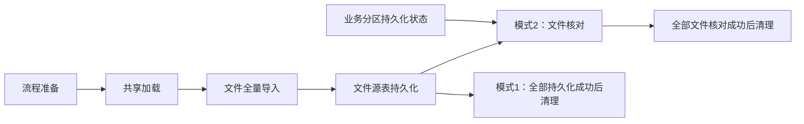

# 磁盘库对比技术设计

## Context

动机见 [proposal.md](proposal.md)。本变更建立在 [sup-wzrsjfx](../sup-wzrsjfx/design.md) 的现有实现上，模式 `1` 继续适用原方案，模式 `2` 以本增量规范为准。原方案尚未归档，主规范目录中没有 SUP 能力，故本次新增三个独立能力并明确覆盖边界。

已核对的实现事实：

| 当前实现 | 设计落点 |
| --- | --- |
| `frame.xml` 的 `600003/600001` 经 `cbs_memdb_sync/export.cpp` 分别绑定 `CMemdbPrePersist/CMemdbPersist::DoClear` | 业务持久化状态接入这两个入口，匹配对象以基类 Cache 阶段筛选、展开后的配置为准 |
| `CMemdbPersistBase::Cache` 已处理配置组、表名、实例类型、NODEX 主分区和子表展开 | 直接复用当前实例最终有效缓存工作集，不新增 Java 全局配置扫描 |
| 持久化在 `Clear` 中执行读取、更新、merge、插入及异步任务汇总；底层存在独立提交 | `Clear` 返回或首个分片完成不等同于分区全部数据已提交，状态发布需检查实际完成边界 |
| `SupFlowService.prepare` 生成一个共享 `660030`、逐文件 `625092` 与 `supFilePersist` | 增加参数快照与模式 `2` 文件核对任务；保留共享加载，避免误删字段转换依赖 |
| `CFileManage::Before/Cache` 清理旧丢弃记录、读取忽略规则；SUP 子类逐条过滤并生成丢弃批次 | 模式分支必须前移到初始化和规则加载，不能只跳过最终过滤调用 |
| `SupPersistConfigService.prepare` 固定生成源表和丢弃表两条配置 | 模式 `2` 仅保留源表配置，核对结果由核对功能自己提交 |
| 查询在 SUP 磁盘源表与 `sup_filedropdata` 间关联，检查当前流程与文件持久化状态 | 核对结果必须落 SUP 磁盘；模式 `2` 查询还需检查本轮核对成功 |
| 模型及 Gauss 基线名称是 `comm_archive_cfg`，字段有 `deletestr`，`archivetype='2'` 表示只删除 | 用户所称 `comm_archivecfg` 按实际对象落地，不另建同名表 |

优先信息源为项目知识库、`cbs_memdb_sync` 模块知识库、MACBS-V3 拆分模型和日终 Gauss 基线。模型由用户维护，本次不修改 JSON。

## Goals / Non-Goals

**目标：** 为业务持久化提供可轮询的完成信号；在原 SUP 流程内按文件生成可靠、可重做的磁盘差集结果；保持模式 `1` 及普通导入兼容。

**边界：** 只比较原始 `id` 是否存在，不比较字段内容，不分析已导入但未生成清算流水；不跨日保留状态、不建历史表、不接入日间流程。原唯一启用文件 `SHJS/SH_JSMX01` 保持，配置驱动代码不硬编码该文件。多文件共表、业务日或文件批次间 ID 复用不自动扩展为本次支持场景。

**已接受的并发限制：** 用户无法保证核对期间业务磁盘表不发生重做、清空、重新导入或其他修改，并明确要求本期不考虑解决这一场景。结果基于各次实际读取的数据，不保证跨库同一时点一致性，可能产生误判；不新增快照、写入锁、核对后状态复查、自动重试或强制先停止核对的要求。

## Decisions

### 1. 状态表存储与生命周期

`sup_filepersistrecord` 仅部署在 COMM 磁盘库，跨分区共用同一权威状态，不依赖 SUP 内存加载。已重新读取用户维护的 `MACBS-V3/tables/comm/sup_filepersistrecord.json` 及对应域，管理器属性为 `phydb`，主键为 `flowchartid+intfid+fileid`，不能误写成分区联合主键。

| 字段 | 模型域 | 约束及用途 |
| --- | --- | --- |
| `flowchartid` | `KDT_FLOWCHARTID` | 主键、非空，实际业务流程编号 |
| `partid` | `KDT_PARTID`，长度 4 | 业务分区；模型允许空，但本功能写入必须提供实际分区 |
| `intfid` | `KDT_INTFID`，长度 32 | 主键、非空，接口标识 |
| `fileid` | `KDT_FILEID`，长度 64 | 主键、非空，文件标识 |
| `busidate` | `KDT_DATE` | 本次清算业务日期，核对时必须匹配 |
| `finish_compute_node` | `KDT_VCHAR4000`，长度 4000 | 逗号分隔的已完成计算节点完整标识；前处理初始化为空集合，不使用 JSON |
| `persiststatus` | `KDT_STATUS`，长度 1 | 前处理显式写入 `0`，状态 `0/1/2/3` 与用户定义一致 |

模型中非主键字段未定义默认值，不依赖数据库 NULL 自动代表初始状态。四种状态在 C++ 使用有业务含义的宏，状态事务及主键绑定位于 `library/macbs/comm/sup_persist_support.h`，由持久化模块维护状态事务，核对模块仅共用状态常量，自动生成 DAO 目录不存放手工业务逻辑，禁止与 `comm_if_file_log.persiststatus` 的二值标志混用。

状态表记录的是公募、私募、普通等业务流程的完成情况。SUP 自己的源表持久化不应为被检查的业务分区产生成功信号，也不能重置业务流程的记录。按第 2 节汇总流程全部计算节点，用户已确认同一业务日、partid、intfid、fileid 只对应一个待检查业务 flowchartid，核对端按分区检查这一流程状态；不改变模型以 flowchartid 为主键组成部分的定义。

日切通过 `patch/gauss/fs_cbs/fs_cbs_comm/2.data/comm_archive_cfg.sql` 配置：目标 `sup_filepersistrecord`、COMM 实例、现有日切删除分组、启用执行、只删除类型、`deletestr='delete from sup_filepersistrecord'`。全表删除无日期或分区条件，这是用户已明确的清理范围；不生成文件归档或 `his_sup_filepersistrecord`。日切必须在当日业务停止后、次日持久化启动前执行，禁止边核对边清空状态。

**批次重置清理（FS-CBS-21660 补充）：** `FlowServiceImpl.clearFlowData()` 按传入流程记录的实际 `flowchartid` 删除该流程全部 `sup_filepersistrecord`，不按模板编号、节点标识或状态筛选。`clearCurAndPostFlowData()` 已将当前批次及已实例化的后置批次逐个交给本入口，沿用该递归即可覆盖，无需改动节点分配或持久化前处理。删除在节点映射及流程数据清理之前执行，错误正常传播，不忽略失败；现有同步清理返回后才进入下一轮初始化。没有状态记录时删除零行也有效，其他批次保持不变。

状态删除使用 `cbs-data-flowctrol` 中专用的 `SupFilePersistRecordBizDao` / mapper，绑定实际流程编号；业务服务只增加注入及一处调用，不修改自动生成 DAO、C++ 状态逻辑、数据库模型或日切配置。正常结束资源释放（`clearComputeNodeData()`、`clearComputeNodeDataByWeb()` 及结束状态更新）不调用状态删除，完成信号须保留到批次重置或日切，供随后执行的 SUP 核对读取。该补充解决完整批次重置后的节点集合残留，不改变已接受的实例级重做及磁盘并发修改限制。

选择 COMM 磁盘表而非每个分区 MemDB 状态，确保不同计算节点读取到同一已提交结果；选择现有删除配置而非新增日切 C++ 逻辑，限定影响面。

### 2. 业务持久化接入及事务边界

**持久化代码修改约束（用户补充）：** 最小程度修改现有持久化代码，新增逻辑尽量提取为职责明确、带业务注释的独立函数，避免主流程因本次改造变得复杂难读。具体执行如下：

- 在模块本地按接口匹配、记录初始化、节点开始处理、成功完成、失败处理等职责封装新增逻辑；节点列表解析/去重、状态 SQL、行锁及状态事务细节在相应函数内部维护，避免散落到原有持久化循环和各个工作线程中。
- `CMemdbPrePersist`、`CMemdbPersist` 的现有阶段方法仅在必要生命周期位置增加简短调用。原有数据读取、任务拆分、线程调度、更新/merge/插入及提交顺序保持原结构；仅在接入状态生命周期确有需要时调整局部控制流，不顺带改写现有持久化算法或重排大段代码。
- 复用既有异常汇总和处理出口，集中调用新增失败处理函数；如需局部异常保护，应保持原异常传播及资源释放语义，不将状态更新逻辑复制到每个分支，也不为这一功能改造公共清算框架。
- 主流程应能直接读出“初始化状态—原有持久化处理—完成/失败状态更新”的关系。函数按业务职责拆分，不将一个简单步骤拆成多层转发，不为本次需求引入通用插件框架或复杂抽象。
- 以最终差异审查验证：原持久化主体的改动限于必要调用和局部保护，新增细节集中且有明确注释，无无关重命名、搬移或全文件格式化。封装不得省略已确定的提交可见性、并发去重和失败状态维护要求。

在 `cbs_memdb_sync` 模块本地封装接口匹配及状态操作，供前处理和实际持久化复用；不改公共清算基类。节点状态辅助函数使用 Cache 阶段得到的最终有效持久化配置，并读取 `supflag='1'` 的文件接口。这里“tabname 中包含 datasql”解释为本次待持久化表集合包含接口的目标表，采用规范化表标识匹配，不用任意子串匹配，避免 `sh_jsmx` 误匹配 `sh_jsmx_bak`。`datasql` 必须能按既有接口定义解释为合法目标表；不执行任意 SQL 文本。

用户最新确认采用按实例重置。保持现有 `dispatchMemdbPersist` 的“本实例前处理→本实例节点持久化”，不修改 Java 日初始化和分发逻辑，不增加全流程统一初始化/前处理屏障。

每个实例前处理在目标表操作前，按本次有效工作集匹配文件并处理状态：不存在则插入 `0`、空节点集合、实际分区和日期；存在则校验日期/分区，按 `comm_inst_compute_node_map` 的当前 `flowchartid+instid` 删除本实例节点成员，其他实例成员不变。旧 `2` 失效为 `1`，已有 `1` 保持，已有 `0` 且集合为空保持 `0`，已有 `3` 保持失败直到全部完成。不删除重建已有状态行；同一文件重复配置只处理一次。单节点独立重做仍只撤销自身，不执行实例级清空。

为保护“状态尚不存在”的并发创建，初始化短事务按计算节点固定顺序锁定本流程的分配映射行，再查询/插入或锁定更新状态行；状态创建与实例节点移除一并提交，事务结束立即释放锁，不持锁等待业务工作。映射为空、日期或分区不符、状态非法均报错。实例前处理与其他实例成功回报共享状态行锁，因此不会覆盖并发完成节点。初始化异常同样由失败守卫尝试独立登记 `3`，原异常保持。

同一天多实例分批重做仍有旧成员窗口：A 已完成本轮、B 尚未开始前处理时，B 上轮标识尚未失效，可能暂时满足完成集合。此场景归入此前接受的业务重做期间核对准确性限制，本期不新增执行轮次、统一屏障或自动重新核对。实例前处理重做须沿用旧执行停止的约定，作用范围为该实例全部旧节点。

正常首次持久化开始处理匹配工作集前，提交状态 `1`；更新不到预处理建立的记录视为状态链路异常，不静默补出成功。任何匹配表的读取、任务分解、更新、merge、插入、提交或完成收尾失败，确保停止/等待本次已启动工作，再在可提交的 COMM 事务中移除自身完成标识、写 `3` 并传播原错误。错误状态写入不能跟随失败的数据事务一并回滚；若 COMM 本身不可用，保留原错误与状态写入错误，不能声称已成功标记失败，核对端最终超时。失败后的单节点重试继续维护完成集合，未全部完成时保持状态 3，不能覆盖其他节点尚未恢复的失败。

每个计算节点仅在本节点对应文件全部应执行的数据工作已成功提交后回报成功。空数据节点也必须完成实际删除/空写流程并回报，不能因零行数据遗漏。成功状态提交失败则节点任务失败，不发布成功。状态范围限于本次流程命中的文件，更新同时核对业务日期。

用户在评审中将完成计数字段改为完成节点列表：以 `comm_inst_compute_node_map.flowchartid` 取得分配给本流程的全部 `compute_node` 完整标识，构成目标集合，不使用 `comm_instance.compute_node_num` 或线程池大小。目标集合必须非空，本轮期间映射不得变动。

`finish_compute_node` 格式为 `nodeA,nodeB,nodeC`，保存的元素为节点地址完整值。按逗号拆分后精确匹配并去重，不采用子串包含，不使用 JSON。无完成节点按空集合解释；规范写入不带首尾逗号或空元素，排序后拼接便于复核。节点标识为空或包含逗号时报告配置错误，不能产生有歧义的列表。以实际编码和字段限制检查序列化结果，超过 4000 上限立即失败，禁止截断。

节点成功回报在 COMM 短事务内锁定当前状态行或使用等价并发保护，读取当前集合、验证日期和节点归属、加入当前节点并去重，然后更新集合与状态。禁止无保护地读出字符串后覆盖并发节点结果。正常无失败情况下，完成集合与分配集合完全相等才置 `2`，尚未齐全保持 `1`；数量相等而成员不同不能成功。局部线程批次全部汇总后才允许本节点回报，重复成功回报不新增成员。存在尚未恢复的失败时，其他节点的局部成功不能清除状态 `3`。

用户已确认必须支持单节点独立重试/重做，并能保证该节点旧执行已完全停止、不会再提交或上报后才重做。因此本期不为这一场景新增执行轮次字段。仅重试已经成功执行的状态回报时，重复加入同一节点是幂等操作；真正重新执行持久化时，先在事务中移除自身旧完成标识，再执行数据修改，成功后重新加入。其他节点完成信息保留，不能为了一个节点重做清空整个集合。原状态为 `2` 时必须在重新修改数据前失效为未完成，使后续状态轮询看到最新状态；已经通过轮询并开始读取磁盘的核对不额外追踪该变化，这属于用户已接受的并发限制。

失败后保留状态 `3`，允许业务节点重试并继续更新完成集合，直到所有分配节点均已完成才恢复 `2`，不因某个节点开始重试就清除失败。SUP 核对任务只要检测到任一状态 `3`，立即报错退出，不继续轮询等待业务重试，也不自动重试或自动恢复；业务状态随后恢复为 `2` 不改变已失败核对任务的结果，必须由人工重新触发核对。人工重新触发后执行完整清理、状态检查和核对流程，若再次检测到 `3` 仍立即退出。

进程被强杀无法保证写 `3`，保留 `0/1` 由核对超时反映；正常异常必须走失败写入路径。当前表语义是当天当前执行状态，同一节点重做前旧执行停止的保证继续成立；这不代表业务持久化与 SUP 核对互斥。不要求业务重做前停止核对，也不自动中断或重跑已经通过状态轮询的核对。

### 3. 模式参数与任务图

| 参数 | 决策 |
| --- | --- |
| `supmode` | 字符业务值 `1/2`，缺失按 `1`；其他值报配置错误 |
| `checkpartids` | 模式 `2` 必填，逗号分隔的分区标识，去首尾空格并去重；空项、通配符、未知分区报错；示例 `1,2,3` 不作为所有客户的隐式默认 |
| `checktimeout` | 模式 `2` 为正整数秒，缺失 `600`；整个核对任务的总超时，包含清理、轮询、磁盘读取、差集和结果写入，模式 `1` 不使用核对参数 |

**启动参数继承（FS-CBS-21660 补充）：** 启动调用通过 `CommFlowchartinfoBizDao.selectBaseInfoByFlowchartid` 查询模板/流程信息，再传入真正初始化入口 `DayInitHandler.dayInit()`。查询投影 `base_column_list` 补齐 `params`；考虑启动调用仍可能将空请求参数传入，参数继承兜底集中在真正初始化入口。该入口在复制入参后、实际流程编号生成前检查最终实例参数：为空时按入参的模板 `flowchartid` 使用现有主键查询补取模板参数，覆盖直接调用或不完整投影的入参；非空请求参数保持优先。

JSON 参数合并读取最终实例 `commFlowchartinfo.params`，使模板兜底值进入 `comm_flowrecord.params` 和 `comm_flowrecordresult.param`。任务参数合并后再调用 `flowEngine.init` 和 `FlowCache.put`，避免流程缓存保留合并前参数；随后沿用既有 INSERT 保存实例及任务。本补充不修改自动生成模型/基础 DAO，既有显式非空参数覆盖、任务字段合并和事务边界保持。模板和请求均未配置时继续默认模式1。已生成实例不会自动补写，需在部署修复后按正常批次重置/初始化重新继承；模板9与实例90330的复现应同时检查实例JSON、任务参数串和缓存参数。

准备时从流程 `params` 解析一次并作为本轮动态任务参数快照，传给加载、导入、持久化和核对；中途修改流程参数不改变正在运行的任务。使用已有分隔格式，如 `supmode=2|checkpartids=1,2,3|checktimeout=600`，不覆盖流程已有其他参数。

采用单一 C++ 核对功能号，在 `cbs_file/file` 增加 `CSupFileCheck::DoClear` 与 `SupFileCheck` 导出，使用 `660031`（已静态检查入口注册）。任务直接用 JNI 执行并绑定同一 SUP 计算节点，能够访问持久化后仍保留的源 MemDB；不经 Java 搬运全量源记录，也不设计三段式恢复/分片/执行入口。

为保持原步骤 `40` 清理兼容，在步骤 `30` 内追加核对任务，拟分配 `390100～399999` 编号段，逐文件 `beforerecordno` 指向自己的 `300100+index` 持久化任务。模式 `2` 文件数上限据此为 `9900`，越界在准备阶段报错；若现有部署可能超过此数量，实施前改用更大无冲突预留段并同步检查，不能编号溢出。步骤 `30` 名称/图示说明“文件持久化与核对”。模式 `1` 仍为 `1+2N` 动态任务，模式 `2` 为 `1+3N`，空清单不生成动态任务。

准备重做删除旧核对任务及结果，模式切回 `1` 同样删除残留核对任务；复用现有本流程节点映射、重新分配结果编号并刷新引擎图，重置后续模板状态。清理检查覆盖所有持久化任务及模式 `2` 核对任务，包括未激活任务；任一失败或未完成均不释放 SUP 节点。现有共享加载暂时保留，因为字段转换仍可能依赖基础表，不擅自将其整体删除。

### 4. 模式 2 的导入和持久化分流

模式参数进入 `CFileManage`、SUP 文件上下文及子类初始化。模式 `2` 从过滤规则读取/预校验开始就跳过：预过滤、正式过滤、按业务主键去重、原 `1/6/4` 不支持规则检查，以及忽略规则查询、预解析、逐行求值；不创建丢弃管理器、不执行旧结果删除、不提交丢弃批次。仅在最终判断返回通过不足以满足本设计，因为此前规则校验仍可能失败。

所有可解析记录完整进入 SUP 源表，原始整数 `id` 保留。文件格式、字段转换、源记录 ID 缺失或类型错误仍按导入错误处理。“跳过过滤”不吞掉文件解析错误。

`SupPersistConfigService.prepare` 按模式原子替换临时配置：模式 `1` 两条，模式 `2` 仅源表；先删除原配置组以免模式切换残留 `_drop`。SUP 文件日志仍仅表示其源数据持久化完成，模式 `2` 不借该二值字段表达“业务分区全部完成”或“文件核对完成”。保留已有导入结果关联，核对任务也携带 `import_result_id`，防止查询或重做串用旧轮次。

### 5. 核对单功能号的七阶段职责

| 阶段 | 责任 |
| --- | --- |
| `GetBusiParam` | 解析模式、分区列表、超时、当前接口/文件、业务日期和本轮导入结果；记录本次任务开始时间，用于简单的总耗时检查 |
| `Before` | 轻量校验后，在 SUP 磁盘按 `intfid+fileid+busidate` 删除旧结果并实际提交；不触碰其他文件 |
| `Cache` | 通过 MemdbManager 绑定当前文件源表及字段元数据，加载忽略规则定义，随后在本阶段内部轮询 COMM 状态并加载磁盘 ID，禁止向前跳阶段 |
| `Check` | 检查累计总耗时；实例、ID、规则及状态有效性已在 Cache 阶段检查 |
| `Clear` | 计算 ID 差集，对缺失记录复用本次忽略规则生成丢弃结果缓存 |
| `After` | 汇总源条数、磁盘去重 ID 数、缺失及忽略条数，记录实例清单和耗时 |
| `Write` | 仅写结果到 SUP 磁盘，通过 PhydbManager 的 `BatchInsert()` 按批次提交，全部批次成功后才返回核对成功 |
| `Fault` | 清理本次未提交资源、恢复连接、传播失败；不恢复旧成功状态，不把局部结果当完整结果 |

核对模块复用基类按线程/数据源缓存的连接，不调用 `CSupPersistCommAccess::Transaction`，不手工借还物理连接。Cache 切换一次 COMM，配置、忽略规则、状态轮询和实例发现均在 COMM 查询；轮询前及每轮末尾提交读事务以刷新快照。读取业务磁盘 ID 时使用 `CXAStack` 切换对应实例，退出恢复 COMM。结果仍存 SUP，Before/Write 使用局部 `CXAStack` 访问 SUP；Before 保留显式删除事务，Write 由 PhydbManager 的 `BatchInsert()` 管理各批事务，不因简化连接而迁移结果表。

用户已确认模式 `2` 仅维护 SUP 磁盘丢弃结果，不清理或写入 MemDB 的 `sup_filedropdata`；模式 `1` 保持原逻辑。Before 的磁盘清理与后续批次插入分别提交，流程失败时以任务状态阻止查询。源表直接使用 MemdbManager，Clear 的差集结果通过 `CSup_filedropdataPhydbManager::Insert` 暂存，Write 通过同一管理器的 `BatchInsert()` 写入磁盘。

源表按用户最新要求直接使用 MemdbManager：在 Cache 阶段通过 `CMacbsMemdbManagerFactory::CreateMemdbManager` 按表名创建，仅绑定源表及字段元数据；Clear 阶段参照现有 `for_next` 实现，通过表句柄在 `CMemdbTableReadLockHolder` 保护下使用 `JstpFirst/JstpNext` 逐条取得记录指针，直接进行 ID 和忽略规则判断。对象由 `unique_ptr` 管理，不调用 `GetAllData()`，不复制完整源记录或建立源指针集合；读锁在本次遍历结束或异常退出时自动释放，统计使用实际遍历数量。源文件在核对期间不被重导覆盖的前提保持不变。`sup_filedropdata` 的新结果仅由 PhydbManager 管理，不进入 MemDB。忽略规则仍直接通过 PhydbManager 读取 COMM，提取原 `InitSupIgnoreRules` 可复用部分和表达式执行器，保持字段命名、类型/文本格式及任一命中语义，不复制另一套算法。

### 6. 轮询和超时

每轮读取当前 busidate 下各个待检查 partid+intfid+fileid 对应的唯一业务流程状态，并保留 flowchartid 用于定位和日志。用户已确认每组只对应一个待核对业务流程：查询无记录继续等待，恰好一条按状态判断，多条则报状态记录歧义错误，不按最新记录、首条记录或任一成功记录通过。不持有贯穿轮询的固定快照事务，其他日期记录不参与判断。状态 0/1 继续等待，2 表示该分区通过，3 立即报错退出。所有指定分区通过才查询磁盘。NULL 或未知值视为数据错误，不无限等待或当成功。每轮间隔可采用 1 秒等待，并检查从任务开始累计的经过时间；错误日志包含接口、文件、流程、未完成分区、最后状态和已等待秒数。

`checktimeout` 经用户确认限制整个核对任务，包含清理、状态轮询、磁盘读取、差集计算及结果写入。任务开始记录时间，轮询循环、批次处理及主要阶段边界检查总经过时间；进入下一阶段不重新计时。任务配置透传同一超时值，沿用现有框架的超时处理，核对固定默认配置不会无意提前截断。采用简单控制，不为每条 SQL/RPC 动态分配剩余毫秒预算，不新增精确取消或强制中断机制；正在执行的阻塞调用允许在返回后的检查点发现超时。检测到超时即报错退出，不继续后续业务步骤或发布成功；已提交数据不承诺回滚，通过任务失败阻止查询，并在人工重做时重新清理。若总耗时不足，由部署调大 checktimeout。

### 7. 业务磁盘实例和 ID 差集

状态全部通过后，按已通过的 `checkpartids` 查 `comm_instance` 中全部业务实例 `instid`，再收集这些记录的 `domainid`，补齐对应域的 `insttype='2'` NODEX。不能仅取每分区第一条实例，也不能只按 SUP 当前业务域补 NODEX；按真实 `instid` 去重，已存在的 NODEX 不重复查询。连接通过 `instname` 及现有实例连接设施获得，日志不记录凭据。历史库、SUP 实例不作为业务落库证据。

**只导入 NODEX 的文件（FS-CBS-21660 补充）：** Cache 查询当前 `intfid+fileid` 的 `datasql` 时同时读取 `zkflag`。`zkflag='2'` 表示文件只导入 NODEX，普通节点可能没有该表：DiscoverInstances 仍可查询 COMM 中普通业务实例元数据用于分区校验，但不将 `insttype='1'` 实例加入实际磁盘查询集合；仅保留现有发现路径中的 `insttype='2'` NODEX。此补充不调整现有 NODEX 发现范围。其他标志继续原有选择逻辑。指定分区持久化状态轮询保持原规则，不能因只查询 NODEX 而绕过等待。仅 NODEX 模式没有目标 NODEX 实例时报错；已存在实例的查询返回零行仍是合法空集合，连接或源表错误正常传播，不当作空结果。

每个指定分区必须有对应业务实例；应存在的域级 NODEX 映射缺失、连接失败、表不存在或 SQL 失败，都应使核对失败，不能降级为空集合生成大量假缺失。查询合法但返回 0 行属于有效空集合。

由当前任务 `intfid+fileid` 精确读取 `comm_if_file.datasql`，验证为模型认可的目标表名。所有磁盘查询只投影 `id`，以流/批量读取构造整数 ID 去重集合，不拉整行；SUP 源表读取当前文件已导入的原始记录，以其原始 ID 做集合判断，不从 SUP 磁盘重载源数据。

设源记录集合为 `M`，全部业务实例的 ID 集合分别为 `D₁…Dₙ`：

`未导入记录 = { r ∈ M | r.id ∉ (D₁ ∪ … ∪ Dₙ) }`

只要任一业务磁盘含有该 ID，该记录就不属于未导入；不是要求每个分区均包含该 ID。ID 全程使用兼容 BIGINT 的整数，不转浮点；跨库重复 ID 只保留一个。缺失记录保留原 `intfid/fileid/id/busidate`，不重新编号。

用户已确认：SUP 与各业务流程对同一 `fileid` 读取的物理文件清单及文件序号映射一致。因此保留当前文件序号与记录序号生成的 ID，直接进行跨流程比较；本次不增加源文件哈希、记录重编号或新的复合关联键。

### 8. 结果、原因和忽略规则

用户已确认：模式 `2` 的 `dropruleid` 使用模型允许的空值，`dropruledesc` 固定为“指定分区磁盘库中未找到记录”，不重新执行过滤规则解释原因，不伪造原始规则编号。仅对差集记录执行当前接口、文件的忽略规则，任意一条命中则 `dropignoreflag='1'`，否则 `'0'`；保留所有缺失记录，忽略只改变标志。

用户确认模式 `2` 按 MemDB 字段值比较忽略规则：复用文件字段映射、AND/IN 及任一命中语义，整数保持整数精度，浮点按字段类型比较，字符串延续原首尾空白处理后精确比较。例如文件数值 `001` 在 MemDB 为 `1`，与规则数值 `1` 或 `001` 相等；不额外保存解析文本。模式 `1` 保留原解析文本口径。无法提供规则字段、表达式非法或规则读取失败均使核对失败，不能默认为不忽略。

核对功能直接写 SUP 磁盘结果，避免再增加丢弃表的通用持久化配置。开始清理已提交，最终插入复用 `CSup_filedropdataPhydbManager::BatchInsert()`，由管理器按批次提交；新结果为空时也完成一次有效空结果发布。任一磁盘批次失败或超时都保持任务失败；此前批次可能已提交，下次重跑先清理再重建，不将局部结果发布为成功。

查询保留原页面、返回字段和忽略标志筛选，模式 `2` 增加当前业务日、当前流程、当前文件本轮核对结果成功检查；仅源表持久化成功不足以开放查询。成功清理移除临时配置和节点映射后，仍能通过本轮任务结果定位 SUP 磁盘实例。单独重做核对也必须使旧结果暂不可查询，不能依赖上次流程完成标志。

### 9. 代码及配置落点

| 范围 | 落点 |
| --- | --- |
| 状态匹配/写入 | `cbs_memdb_sync/memdb_sync_base` 模块本地辅助逻辑及 `memdb_prepersist`、`memdb_persist`，含实际异常和多任务完成出口 |
| 导入分支 | `cbs_file/file/filemanage.*`、`kfintf_process_to_mem_sup.h`、`filter_manager_sup.h`、`sup_file_context.h` 及必要最窄派发点 |
| 新核对入口 | `cbs_file/file` 内新类、该目录 `export.cpp`、父/子 `CMakeLists.txt`、全部适用 `frame*.xml` |
| Java 编排 | `SupFlowService`、`SupPersistConfigService`、`SupFilePersist`、`SupFlowCleanup`、`SupMode`、相关 DAO XML；业务持久化的 Java 日初始化/分发保持原样 |
| 查询就绪 | `SupQueryHandler`、`SupQueryDao.xml` 的当前文件本轮核对检查 |
| 增量 DDL | `patch/gauss/fs_cbs/fs_cbs_comm/1.table/sup_filepersistrecord.sql`，一表一文件 |
| 增量 DML | `patch/gauss/fs_cbs/fs_cbs_comm/2.data/comm_archive_cfg.sql` 与既有 `2.data/flow/9_全量数据导入分析/` 分组 |

用户已确认本次增量沿用需求编号 `FS-CBS-7768`，所有新增或修改 SQL 注释及交付标识统一使用该编号。客户目录如存在同名流程或归档配置，核对覆盖关系。关键方法、分支和业务条件必须有业务注释，字符业务标志使用宏/常量。

## Risks / Trade-offs

- 多计算节点同时回报可能覆盖列表或提前成功 → 事务内锁定状态行，按完整节点标识去重，完成集合与分配集合完全相等才满足完成条件。
- 重复成功回报与真正的数据重做不能混淆 → 前者幂等加入，后者先移除本节点旧标识再执行；用户已保证重做前旧执行停止，无迟到提交或上报。
- 逗号列表容量和解析歧义 → 节点标识禁止逗号，精确拆分匹配，长度超限报错而不截断。
- 业务状态恢复不等于核对任务恢复 → 状态 3 保持到完成集合齐全后才能转 2；核对发现 3 立即退出，恢复后必须由人工重新触发核对，不能后台自动继续。
- 源记录 ID 依赖物理文件枚举顺序 → 已核对 SH_JSMX01 的 id 使用序号来源，m_nFileSno 与记录序号组合生成 ID。用户已明确保证 SUP 与各业务流程同一 fileid 的物理文件清单及文件序号映射一致；按这一已确认前提直接比较 ID，不新增记录身份算法。
- 业务重做或其他修改与核对读取并行 → 用户已明确接受本期不解决；跨库读取可能混合不同时点数据，不能保证这一场景下的差集结论准确，不增加并发隔离或自动恢复机制。
- 日切与状态轮询并行 → 日切仍按既有流程边界清理；业务磁盘表并发修改的范围豁免不改变日切配置及其原有执行约定。
- 简单超时检查不能保证恰在指定秒数中断阻塞调用 → 用户已接受不精确控制；在返回后的检查点失败，结果是否可用仍以任务成功状态为准。
- 全部磁盘 ID 并集占用内存 → 仅投影 ID、批量读取并去重，记录规模和峰值估计；超出可用资源时报错，不截断集合继续出结论。
- 检查时磁盘空表与查询失败含义不同 → 只有所有实例查询成功的空结果才有效，任何遗漏实例或查询错误都阻止发布。
- 模式 `2` 不执行原过滤规则 → 只有磁盘缺失事实和统一原因，没有具体过滤规则解释；用户已接受该差异，忽略规则继续保留。

## Migration Plan

1. 按已核对的七字段模型核对 DDL 与业务层 `CSupPersistRecord`，手工事务辅助放 `library/macbs/comm/sup_persist_support.h`，以 `FS-CBS-7768` 交付；使用最新 finish_compute_node 逗号集合字段，按失败恢复与人工重触发约定实施，不自动改 JSON。
2. 交付 COMM 新表和日切删除配置，先保持流程 `supmode=1`；不改全量脚本，不直接执行数据库脚本。
3. 交付 Java/C++ 模式参数、状态维护、核对及查询完成判定，核对入口注册和调度超时设置。
4. 在明确的业务日与分区范围验收 `SHJS/SH_JSMX01`，先运行业务实例前处理创建状态或撤销本实例完成节点，再执行模式 `2`；已有业务持久化但没有新表状态时应重跑相应链路，不能手工假置 `2`。
5. 回退配置到 `supmode=1` 时停止当前核对，再重新准备流程以删除旧核对任务并重建原配置；保留新状态表及删除配置，不做破坏性删表。新运行按旧模式重新生成丢弃结果。

## 评审结论

本轮待确认事项已收敛：沿用 FS-CBS-7768；完成节点保存为逗号列表，支持旧执行停止后的单节点重做；状态 3 使核对立即退出，后续由人工重新触发；checktimeout 为整任务总超时，采用简单检查；同 fileid 的物理文件清单及序号映射一致；每个业务日、分区、接口、文件只对应一个待核对业务流程。

业务表并发修改时的核对准确性是用户已接受的本期限制，不列为待解决事项。代码与增量 SQL 已实施，静态检查及部署说明见 `implementation.md`；构建、数据库执行及业务验收尚未运行。

## 实施补充：流程参数存储格式

`comm_flowchartinfo.params` 使用 JSON 对象，由现有日初始化解析并合并进 `comm_flowrecord.params` / `comm_flowrecordresult.param` 的竖线键值文本。增量 SQL 仅为空流程参数设置 `{"supmode":"1","checktimeout":600}`，已有非空参数保持，缺省值由统一解析器处理。模式 2 示例为 `{"supmode":"2","checkpartids":"1,2,3","checktimeout":600}`。这一格式要求不改变 `finish_compute_node` 的逗号字符串约定。
