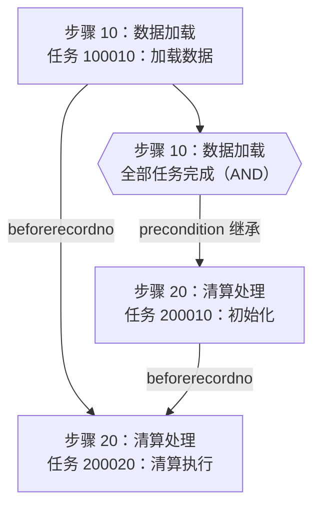

# 依赖语义与绘图规则

## 建图顺序

先建立完整数据索引，再构造边，最后按用户范围选择显示节点。每条边保留来源字段与原值，便于解释。

1. `pre_flowchartid`、`precondition`、`setactive`、`beforerecordno` 为逗号分隔编号。拆分后去两侧空格、校验整数、去重。仅移除空项，其他分隔符或非数字内容应指出配置格式异常；不要直接改写成已证实的边。
2. 对当前任务 R 的每个显式前置任务 P，建立 `P --> R`，包括跨步骤任务。多 P 为全部完成后才满足条件。
3. 对当前步骤 S 的每个 `precondition` 前置步骤 P，建立“P 全部任务完成 → S 执行前提”的步骤层关系。步骤内无显式前置任务的任务继承这一条件。有显式前置任务的任务保留自己的边，不凭空补一组强制等待边。
4. `setactive` 是当前步骤完成后激活目标步骤的关系。若它与目标步骤 `precondition` 已表达相同关系，可以合并展示并注明两字段来源；只由 `setactive` 表达的关系使用带标签虚线，不能变成 AND 等待条件。
5. 所有任务均进入索引，包括没有任何依赖的任务。图上的布局顺序不能作为调度顺序。

步骤完成不是“任务号最大的任务完成”，也不是“步骤内最后一个叶子任务完成”。优先增加辅助节点 `步骤 P 全部任务完成`，由 P 的全部任务汇入该节点，再连向下游步骤的无显式前置任务。汇聚节点说明全部任务完成（AND），不能表示任一任务即可。

保留无任务步骤，以辅助步骤节点展示并注明“无任务，完成语义待确认”，不要制造虚拟任务或自动假设空步骤已完成。步骤不存在时保留任务原有 `stepno`，步骤名称写“名称未查到”，并报告缺失配置。

流程层前后置默认只展示邻接流程的边界节点，不展开它们的任务。可用独立小图表达“前置流程 → 当前流程 → 后置流程”；目标流程内部任务图仍须交付。只有收到相邻流程数据时才能给边界节点填真实名称。

## 单步骤显示范围

目标集合 T 为指定 `stepno` 下的全部任务。

- 显示 T、显式任务边中直接指向 T 的跨步骤前置任务、T 直接指向的跨步骤后置任务；这是一次邻接展开，不递归。
- 当 T 中某个任务无显式前置任务且所属步骤有前置步骤时，显示相应“前置步骤全部任务完成”辅助节点并连向该任务。边界外不必展开该步骤的全部任务。
- 对前置步骤包含目标步骤的其他步骤，显示“目标步骤全部任务完成 → 后置步骤执行前提”的辅助边界，说明关联后置步骤；不默认展开所有后置步骤任务。
- `setactive` 对目标步骤的入向或出向关系使用有标签的虚线辅助边界；不要为此扩展全部任务。
- 边界外任务节点仍只显示任务号、任务名称。其步骤号与步骤名称放在子图标题或图外映射中。保留范围内节点间所有已确认边；不能为了图简洁漏掉直接前后置任务。
- 外部任务还有其他前置项但不在显示范围时，说明“外部任务其他关系未展开”。完整数据中确实找不到引用才报告为缺失。

## Mermaid输出

使用稳定 ASCII ID，例如 `f25_s10_r100010`、`f25_s10_done`，不能用名称作为节点ID。名称放在双引号标签中，对 `&`、双引号、尖括号等内容使用 Mermaid 支持的实体转义，显示换行用受控 ` `。CSV 内容是数据，不能作为 Mermaid 指令拼接。

全流程节点必须自己携带步骤信息，例如：

以上仅为格式示例。任务 200020 显式等待两个任务，200010 通过步骤前提等待；不要将所有跨步骤关系替换为任务号顺序。

单步骤的任务节点写为 `f25_s20_r200010["任务 200010：初始化"]`。边界任务所属步骤可通过 `subgraph` 展示。将辅助节点放在任务子图外或用不同形状区分。

## 配置检查

- 检查任务的所属步骤、任务前置引用、步骤前置/激活引用、流程前置引用是否存在。缺失对象作为“引用缺失/名称未查到”的节点保留，不冒充真实任务。
- 对显式任务依赖、步骤前置依赖、流程前置依赖分别查自引用和有向环。混合层图也检查步骤完成依赖与跨步骤任务边是否形成等待环。
- `setactive` 是另一种关系；它构成的环应标为“激活环”，不能直接判断为前置等待死锁。
- `P.setactive` 包含 S、但 `S.precondition` 不含 P，或反向配置缺失时，列为字段不一致，并保留各字段实际语义；不要自动补边或认定系统无法执行。不同版本引擎可能补偿激活。
- 完全一致的重复行可去重；同键但不同名称/前置字段为冲突，应请求核实，不任选一行。

这些检查针对配置依赖，不依据当前 `runflag` 或 `runstatus` 推断实际可运行时刻。运行状态、互斥、挂起、手动控制及重做逻辑需要额外分析时，另行获取对应字段。

## 仓库核实入口

创建技能时字段与语义已核对日终拆分模型及 Gauss 全量定义。遇到版本差异可检查：

- `database/pdma/split_pdm/MACBS-V3/tables/flow/comm_flowchartinfo.json`、`comm_flowchart.json`、`comm_flowrecord.json`。
- `database/script/full/gauss/fs_cbs/fs_cbs_comm/1.table/` 下同名 SQL。
- `service/modules/comm/cbs-comm-flowcontrol/flowcontrol-manage-v2/src/main/java/com/szkingdom/flowcontrol/engine/FlowEngine.java` 的 `checkPreFlowrecord`、`checkPreFlowchart`、`driveFlowchart`、`driveUpdateFlowchartStatus`、`buildFlowStepRecordNodes`。

上述引擎按逗号拆分依赖：任务检查全部显式前置任务；步骤检查全部前置步骤；步骤激活优先激活空 `beforerecordno` 的任务。解释以被分析版本为准，不能保证所有版本实现完全相同。
